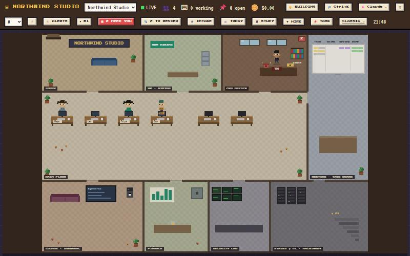
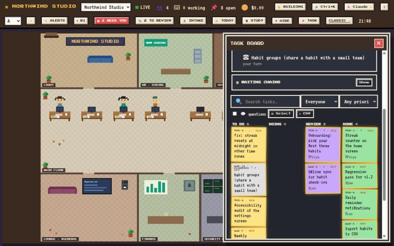
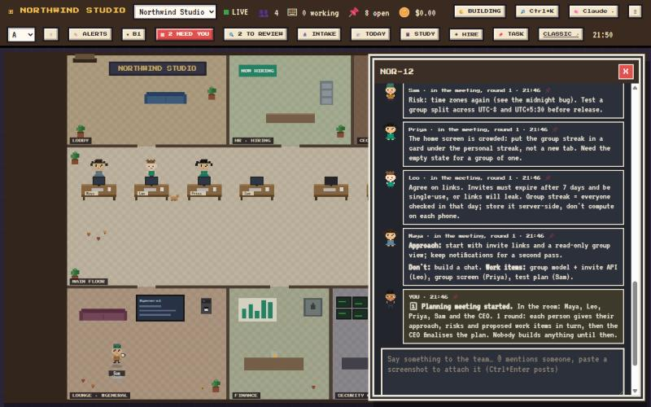
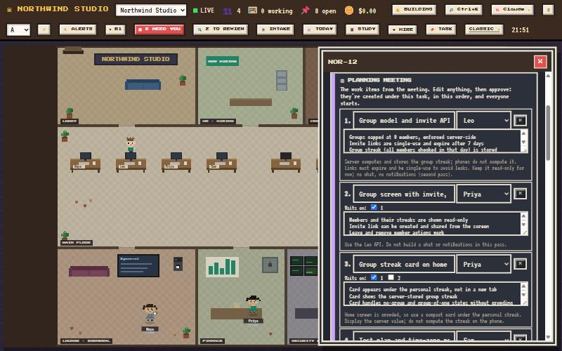
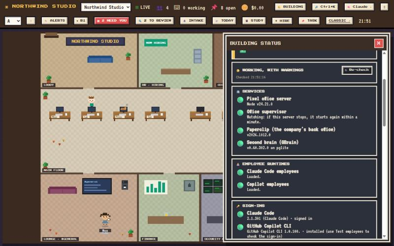

# Virtual Office

A personal "virtual company" of AI employees, run from a pixel-art office.

- **[Paperclip](https://github.com/paperclipai/paperclip)** is the company: org chart, tasks, approvals, budgets, heartbeats.
- **Pixel Office** (`pixel-office/`) is the CEO's UI: every Paperclip screen is a room in a pixel building.
- **Employees** are Claude Code or GitHub Copilot sessions (`adapters/copilot-local/` adds Copilot).
- **[gstack](https://github.com/garrytan/gstack)** gives employees role playbooks (`/qa`, `/review`, `/autoplan`…).
- **Second brain**: a CEO handbook every employee reads, plus searchable memory in [GBrain](https://github.com/garrytan/gbrain).



_Screenshots show a demo company ("Northwind Studio"); your office shows your own company and team._

## What the office does

- **Bring in work**: the 📥 Intake desk turns Azure DevOps work items, GitHub issues/PRs or any link into tasks for the team lead; tasks keep a live link to the source, and **Report back** posts the team's summary on the ADO/GitHub item (after you confirm).
- **Plan together first**: every new feature waits for a 🗓 planning meeting. The attendees take turns in one meeting thread (approach, risks, what not to do, proposed work items), over one or two rounds; you add your input; the office drafts the child work items (owner, order, "done when"); once you approve, they're created and everyone works independently. Each turn is one shift for that employee. Tick "No meeting needed" for small things, or switch the hold off on the task board.
- **Run the work**: a drag-and-drop task board with search and filters; task panels with documents (with revisions), work products (PRs, branches, commits), sub-tasks, blockers and attachments.
- **Watch the team**: look over an employee's shoulder at their live run (or replay their last shift); 🔔 desktop alerts when someone needs you, a task hits review or an employee errors.
- **Stay on top**: 📰 Today (a copyable stand-up report), 🟢 Building status (every service and sign-in, with fixes), Ctrl+K to jump anywhere.
- **Company memory**: the 📓 Study holds the CEO handbook and the brain; import a folder of notes in one go.
- **Office hours**: optionally close the company outside working hours; it reopens itself in the morning.
- **Less admin**: a ☀ morning briefing, 🤖 Ask the office (questions answered from your tasks and the brain), a Friday weekly review, time off for employees with handover notes, recurring tasks, and a phone view over your own Tailscale network.

| | |
|---|---|
|  |  |
| **Task board**: drag notes between columns; filters, saved views, bulk edit, CSV. | **Planning meeting**: the team gives its approach, risks and what not to do, in turn. |
|  |  |
| **The plan**: work items drafted from the meeting; edit, then approve. | **Building status**: every service and sign-in, with a fix for anything red. |

## Layout

| Path | What |
|---|---|
| `pixel-office/` | React + Vite front end on Paperclip's API. The office's own helpers run in the Vite server, one file each (`pixel-office/*.ts`): e.g. `meetings.ts` (planning meetings), `brain-bridge.ts` (brain and note import), `intake-bridge.ts` (ADO/GitHub via `az`/`gh`), `status-bridge.ts` and `setup-check.ts` (building status), `watchdog.ts` (restarts Paperclip and the brain), `backup-bridge.ts`, `ask-office.ts`, `phone-gateway.ts` |
| `adapters/copilot-local/` | Paperclip adapter that runs employees on GitHub Copilot CLI |
| `brain/ceo-handbook.template.md` | Template for your company's CEO handbook (copy into your private company repo) |
| `scripts/` | `gstack_equip.py`, `brain_equip.py` (equip employees), `handbook_sync.py` (handbook file ⇄ Paperclip), `make_icon.py` (desktop icon) |
| `launch-office.ps1` | One-click start: brain → Paperclip → pixel office, opens an app window |
| `start-*.ps1`, `stop-office.ps1` | Start or stop each piece |
| `office-supervisor.ps1` | Started by the launcher: restarts the office server if it stops (Paperclip and the brain are restarted by the office itself) |
| `assets/` | Desktop icon |

Not in git (see `.gitignore`): `.paperclip/` (company database), `.brain/` (tokens), `.office/` (office settings), `.tools/` (portable Node and Bun), `vendor/` (reference clones), and `company/`.

## Your company's data stays private

This repo is the product only. Everything specific to *your* company (handbook, agent
instructions, projects) belongs in a **separate private repo** checked out at `company/`
(git-ignored here). Suggested contents:

- `company/handbook/ceo-handbook.md`: your handbook, from `brain/ceo-handbook.template.md`. Publish with `python scripts/handbook_sync.py push company/handbook/ceo-handbook.md`.
- `company/paperclip-export/`: refresh with `pwsh scripts\export-company.ps1`, then commit in `company/` (secret values are never exported).

The live databases (`.paperclip/`, `~/.gbrain`) are never committed anywhere; back them up separately.

Using two machines (say a PC and a laptop)? Each backup is signed with the machine's name (the
computer name, or `VIRTUAL_OFFICE_MACHINE` if you set it), and the office warns when the other machine
has backed up more recently, with a one-click pull, so neither works from an old copy.

## Set up your own office

Everything runs on your own Windows PC: the company database, the office, the brain and the employees. Nothing is hosted for you, and nothing leaves the machine unless you send it (to GitHub, ADO or your own private repo).

### 1. What you need

- **Windows 10 or 11**, with **Git for Windows** and **PowerShell 7**:
  ```powershell
  winget install Git.Git Microsoft.PowerShell
  ```
- **At least one AI to employ**:
  - **Claude Code** (with a Claude subscription or API key): install from [claude.com/claude-code](https://claude.com/claude-code), or `npm i -g @anthropic-ai/claude-code`.
  - and/or **GitHub Copilot CLI** (with a Copilot plan): `npm i -g @github/copilot`.
- **Python 3** for the small helper scripts (handbook and brain).
- Optional:
  - `gh` (GitHub CLI) and `az` (Azure CLI) let the intake desk look up GitHub and Azure DevOps items: `winget install GitHub.cli Microsoft.AzureCLI`.
  - [Tailscale](https://tailscale.com) enables the phone view.

### 2. Install

```powershell
git clone https://github.com/YogeshPraj/VirtualOffice.git
cd VirtualOffice
pwsh -ExecutionPolicy Bypass -File .\setup.ps1
```

(Or skip straight to `pwsh .\launch-office.ps1`: on a fresh clone it runs `setup.ps1` for you first.)

`setup.ps1` is safe to re-run; finished steps are skipped. It:

1. downloads portable Node 24 and Bun into `.tools\` (checksum-verified; your system Node/Bun is untouched),
2. installs the npm packages,
3. installs gstack into `~\.claude\skills\gstack` (no changes to your global Claude settings),
4. installs GBrain, creates a local brain in `~\.gbrain` and mints its tokens into `.brain\`,
5. connects the brain to Claude Code and Copilot CLI (user-level MCP),
6. puts a **Virtual Office** icon on the desktop.

`-SkipGlobal` sets up only this folder (runtimes and packages) without touching your user profile (no gstack, brain wiring or icon).

### 3. Sign in and open the office

```powershell
claude auth login     # for Claude employees
copilot login         # for Copilot employees
```

Double-click **Virtual Office** on the desktop (or run `pwsh .\launch-office.ps1`). It starts:

- the brain (port 3131);
- Paperclip, the company back office (port 3100);
- the pixel office (port 5180).

Then it opens the office in an app window. The first start takes a minute or two. From then on, a small supervisor keeps the office running, and the office restarts Paperclip or the brain if they stop. `stop-office.ps1` shuts everything down. Building status can also open the office when you sign in to Windows.

### 4. Found your company

The first screen asks for a **company name** and an optional **mission**. If you already have a company on another machine, clone your private company repo into `company/` first; the same screen then offers to **import** it (see [Moving to another machine](#moving-to-another-machine)).

### 5. Hire your team

Open **HR** (or **+ Hire** at the top). Pick a preset (engineer, QA, manager…) or start blank, choose whether they run on **Claude Code** or **Copilot**, and who they report to. A good first team is a manager, one or two engineers and a QA. Each employee works in short **shifts**: they wake up, read their task and its thread, work, comment, and stop. Every shift uses your Claude or Copilot plan.

### 6. Tell them how you work

Copy `brain/ceo-handbook.template.md`, fill in how you like to work (priorities, standards, what needs your approval), and publish it so every employee reads it:

```powershell
python scripts\handbook_sync.py push path\to\ceo-handbook.md
python scripts\brain_equip.py    # gives every employee the brain and the handbook
python scripts\gstack_equip.py   # gives them gstack's role playbooks (/qa, /review…)
```

### 7. Give them their first feature

- **Create a task:** Ctrl+K, type what you want and choose "New task"; or pin it on the task board; or bring it in from ADO or GitHub at the 📥 intake desk.
- **Plan it:** new features wait for a **🗓 planning meeting**. Pick who's in the room and press **Start**. They take turns, then you add your input and approve the drafted work items. After that, everyone works independently.
- **Follow along:**
  - watch them at their desks, or look over their shoulder;
  - check the Lounge for the team's chatter;
  - review finished work in the 🔍 review room, where you approve it or send it back with a note.

Small things can skip the meeting ("No meeting needed").

### 8. Keep your company safe

- Make a **private** GitHub repo for your company and clone it into `company/` (git-ignored here); see [Your company's data stays private](#your-companys-data-stays-private). Building status → **Back up now** (or Ctrl+K) commits your company's export and office settings there.
- Secrets (tokens for ADO, GitHub…) go in the 🔐 **vault** in the basement. They are never exported, never written to the brain, and **Leak watch** flags any pasted into a task.

### Moving to another machine

Install as above, clone your private company repo into `company/`, and open the office. The first screen imports your company. Then Building status → **Move-in checklist** walks you through the rest, with a button for each step:

- restore office settings;
- pull the latest copy;
- re-enter vault secrets;
- check your employees.

With two machines, the office warns when the other one has backed up more recently.

### If something's not right

**Building status** (top right) checks every service, runtime and sign-in, and gives a fix for anything red; its **Setup check** looks at the machine itself (tools, sign-ins, ports, disk). Each piece logs to the office folder: `.paperclip-run.log`, `.office-run.log`, `.brain-run.log` and `.supervisor-run.log`. Paperclip's version is pinned in `start-paperclip.ps1`; upgrade it on purpose.

## Licenses

Original code in this repository: [MIT](LICENSE). Character sprite templates are ported from agent-virtual-office (MIT, see `pixel-office/THIRD_PARTY_LICENSE_agent-virtual-office.txt`).
Third-party components and their terms: [THIRD_PARTY_NOTICES.md](THIRD_PARTY_NOTICES.md).
